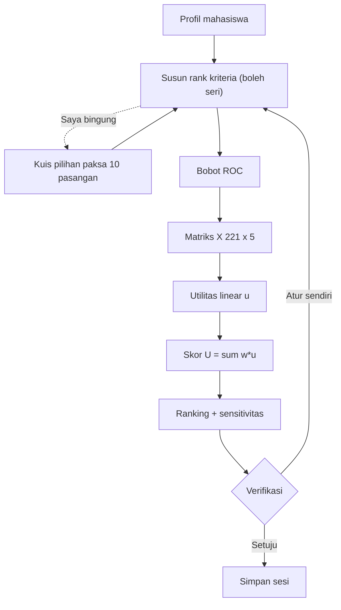

# Sistem Pendukung Keputusan Rekomendasi Pekerjaan Part-Time untuk Mahasiswa Menggunakan Metode SMARTER

**Studi kasus:** Mahasiswa Program Studi Informatika, Universitas Kristen Krida Wacana (UKRIDA), Jakarta
**Metodologi pengembangan:** CRISP-DM (Business Understanding → Data Understanding → Data Preparation → Modeling → Evaluation → Deployment)
**Metode SPK:** SMARTER (Simple Multi-Attribute Rating Technique Exploiting Ranks) + pembobotan ROC (Rank Order Centroid)
**Tahun:** 2026

---


## 1. Judul Aplikasi

**Sistem Pendukung Keputusan Rekomendasi Pekerjaan Part-Time untuk Mahasiswa Menggunakan Metode SMARTER (Studi Kasus: Mahasiswa Informatika UKRIDA)**

Aplikasi ini membantu mahasiswa memilih lowongan kerja *part-time* yang paling sesuai dengan profil dan prioritasnya. Data lowongan dikumpulkan dari empat portal kerja (Glints, Loker.id, KitaLulus, Kalibrr), dibersihkan, lalu diberi peringkat secara personal untuk setiap mahasiswa.

Wujud aplikasi:
- **Spreadsheet perhitungan** (Excel): `docs/spreadsheet/SPK_SMARTER_PartTime_UKRIDA_Spreadsheet_v4.xlsx`, plus contoh mahasiswa riil `SPK_SMARTER_REAL_MHS-R008_v1-BARU.xlsx` dan `SPK_SMARTER_REAL_MHS-R050_v1-BARU.xlsx`.
- **Pipeline data** (Python, folder `src/`): membentuk matriks keputusan dari data mentah.
- **Portal web** (React + Vite, folder `web/`): kuesioner preferensi, penentuan rank kriteria, hasil rekomendasi, analisis sensitivitas, dan verifikasi oleh pengguna.

---

## 2. Identitas Kelompok

| No | NIM | Nama Mahasiswa |
|---|---|---|
| 1 | 412024022 | Brandon Jeremiah Sutedja |
| 2 | 412024043 | Andrew Linardi |
| 3 | 412025014 | Raffael Benediktus Lolaroh |
| 4 | 412025021 | Michael Aaron Sipahutar |

Program Studi Informatika, Fakultas Teknologi Cerdas, Universitas Kristen Krida Wacana (UKRIDA), Jakarta.

---

## 3. Metode yang Dipilih

**SMARTER — Simple Multi-Attribute Rating Technique Exploiting Ranks** (Edwards & Barron, 1994), dengan pembobotan **ROC (Rank Order Centroid)**.

SMARTER adalah pengembangan dari SMART. Pada SMART, pengambil keputusan harus memberi angka bobot sendiri, misalnya "gaji 40%, lokasi 25%". Pada SMARTER, pengambil keputusan **cukup mengurutkan kriteria** dari yang paling penting. Urutan itu lalu dikonversi menjadi bobot numerik dengan rumus ROC.

Ringkasan komponen metode:

| Komponen | Isi pada proyek ini |
|---|---|
| Alternatif (A) | 221 lowongan *part-time* hasil seleksi data |
| Kriteria (C) | 5 kriteria: C1 Kategori, C2 Gaji, C3 Lokasi, C4 Jam Kerja, C5 Skill |
| Jenis kriteria | Semua **Benefit** (makin besar makin baik) |
| Pembobotan | ROC dari urutan prioritas mahasiswa |
| Normalisasi | Fungsi utilitas linear (min–max) ke skala [0,1] |
| Agregasi | Penjumlahan terbobot (*additive*) |
| Output | Skor U(Ai) dan ranking lowongan per mahasiswa |

---

## 4. Alasan Pemilihan Metode

1. **Mudah bagi pengguna non-teknis.** Mahasiswa cukup menyusun urutan prioritas ("gaji paling penting, lalu jam kerja, …"). Mereka tidak perlu menebak angka bobot yang abstrak.
2. **Bobot objektif dan konsisten.** ROC mengubah urutan menjadi bobot yang selalu berjumlah 1. Metode ini tidak memerlukan matriks perbandingan berpasangan dan uji konsistensi seperti AHP, sehingga kuesioner tetap pendek.
3. **Transparan dan dapat ditelusuri.** Setiap langkah (nilai mentah X → utilitas u → skor U → ranking) bisa dihitung ulang dengan rumus Excel sederhana (`MAX`, `MIN`, `SUMPRODUCT`, `RANK`).
4. **Cocok dengan karakter data.** Kelima kriteria bertipe *benefit* tetapi satuannya berbeda (rasio gaji, skor lokasi, selisih jam, *cosine similarity*). Normalisasi linear SMARTER menyamakan semuanya ke skala [0,1] secara adil.
5. **Personal per mahasiswa.** Nilai C1–C5 dihitung relatif terhadap profil masing-masing mahasiswa (minat, gaji minimum, domisili, jam ideal, skill). Urutan prioritas juga ditentukan oleh mahasiswa itu sendiri, sehingga dua mahasiswa bisa mendapat rekomendasi berbeda dari 221 lowongan yang sama.
6. **Ringan secara komputasi.** Perhitungan bisa dijalankan langsung di browser secara *real-time*, termasuk analisis sensitivitas ketika pengguna mengubah prioritasnya.

Perbandingan singkat dengan metode lain:

| Metode | Kebutuhan input bobot | Catatan |
|---|---|---|
| SMART | Angka bobot langsung | Sulit bagi pengguna awam |
| AHP | Perbandingan berpasangan + uji konsistensi | Kuesioner panjang, rawan tidak konsisten |
| TOPSIS | Bobot tetap harus ditentukan terpisah | Fokus pada jarak ke solusi ideal |
| **SMARTER** | **Cukup urutan prioritas** | **Sederhana, bobot otomatis via ROC** |

---

## 5. Rumus Utama

### 5.1 Bobot ROC (Rank Order Centroid)

$$
w_j = \frac{1}{K}\sum_{k=r_j}^{K}\frac{1}{k}, \qquad K = 5
$$

`r_j` = posisi rank kriteria ke-j (1 = paling penting). Bobot untuk K = 5:

| Posisi rank | Perhitungan | Bobot |
|---|---|---|
| 1 | (1 + 1/2 + 1/3 + 1/4 + 1/5) / 5 | **0,4567** |
| 2 | (1/2 + 1/3 + 1/4 + 1/5) / 5 | **0,2567** |
| 3 | (1/3 + 1/4 + 1/5) / 5 | **0,1567** |
| 4 | (1/4 + 1/5) / 5 | **0,0900** |
| 5 | (1/5) / 5 | **0,0400** |
| **Total** | | **1,0000** |

> **Catatan penting:** lima angka bobot ini selalu tetap untuk K = 5. Yang membuat hasil personal adalah **kriteria mana yang ditempatkan pengguna di posisi mana**. Contohnya, jika mahasiswa A menaruh Gaji di rank 1, bobot Gaji = 0,4567. Jika mahasiswa B menaruh Gaji di rank 3, bobot Gaji = 0,1567.

**Perluasan untuk rank yang sama (seri).** Jika dua kriteria atau lebih dinilai sama penting, kriteria tersebut menempati posisi yang berurutan dan **berbagi rata-rata bobot posisi itu**:

$$
w_{\text{seri}} = \frac{1}{q-p+1}\sum_{t=p}^{q} \text{ROC}(t)
$$

Contoh: Gaji dan Jam Kerja sama-sama rank 1, sehingga keduanya menempati posisi 1–2:
w = (0,4567 + 0,2567) / 2 = **0,3567** untuk masing-masing. Total bobot tetap 1.

### 5.2 Nilai mentah kriteria (X_ij)

| Kriteria | Rumus |
|---|---|
| C1 Kategori | 1,0 jika `job_category` = minat mahasiswa; 0,3 jika berbeda |
| C2 Rasio Gaji | `min( work_salaryperhour / min_expected_salary , 2,0 )` |
| C3 Lokasi | 1,0 jika Remote atau satu wilayah dengan domisili; 0,8 jika sesama Jakarta; 0,4 wilayah lain |
| C4 Jam Kerja | `max( 0 , 1 − |work_hours − jam_ideal| / 20 )` |
| C5 Skill | Cosine similarity TF-IDF antara skill mahasiswa dan skill lowongan, rentang [0,1] |

### 5.3 Fungsi utilitas linear (normalisasi, semua Benefit)

$$
u_j(X_{ij}) = \frac{X_{ij} - X_j^{\min}}{X_j^{\max} - X_j^{\min}}
$$

Jika `X_max = X_min`, maka `u_j = 1` (semua alternatif setara pada kriteria itu).

### 5.4 Skor akhir SMARTER

$$
U(A_i) = \sum_{j=1}^{5} w_j \cdot u_j(X_{ij})
$$

### 5.5 Ranking

Alternatif diurutkan menurun berdasarkan U(Ai). Skor tertinggi = Rank 1 = rekomendasi terbaik.
Di Excel: `=RANK(G19,$G$19:$G$28)`. Di web, skor yang sama dipecah secara deterministik dengan urutan: skor → C2 → C5 → `job_id`.

### 5.6 Rumus pendukung C5 (TF-IDF dan Cosine Similarity)

$$
w_{t,d} = \text{TF}(t,d)\times \text{IDF}(t), \qquad
\cos(\vec{V}_S,\vec{V}_A)=\frac{\sum_k V_{S,k}V_{A,k}}{\sqrt{\sum_k V_{S,k}^2}\sqrt{\sum_k V_{A,k}^2}}
$$

### 5.7 Implementasi rumus di Excel (sheet `SMARTER`)

| Langkah | Rumus Excel |
|---|---|
| Bobot ROC rank 1 | `=(1/1+1/2+1/3+1/4+1/5)/5` |
| MAX / MIN kriteria | `=MAX(B6:B15)` / `=MIN(B6:B15)` |
| Utilitas | `=(B6-$B$17)/($B$16-$B$17)` |
| Utilitas (aman bagi nol) | `=IF($B$16=$B$17,1,(B6-$B$17)/($B$16-$B$17))` |
| Skor SMARTER | `=SUMPRODUCT(B19:F19,$B$5:$F$5)` |
| Ranking | `=RANK(G19,$G$19:$G$28)` |
| Ambil pemenang | `=VLOOKUP($M$4,$H$19:$J$28,2,FALSE)` |
| C1 | `=IF(kategori=minat,1,0.3)` |
| C2 | `=MIN(gaji/gaji_min,2)` |
| C4 | `=MAX(0,1-ABS(jam-jam_ideal)/20)` |

---

## 6. Tahapan Algoritma

### 6.1 Tahap persiapan data (CRISP-DM Fase 3)

| Langkah | Proses | Hasil |
|---|---|---|
| 1 | Scraping lowongan dari Glints, Loker.id, KitaLulus, Kalibrr | 535 data mentah |
| 2 | L1 Deduplikasi (ID, URL, lintas portal) | −130 → 405 |
| 3 | L2 Filter kata kunci negatif (full-time, freelance, magang, manajer) | −13 → 392 |
| 4 | L3 Filter jam kerja > 30 jam/minggu | −1 → 391 |
| 5 | L4 Filter anomali gaji dan scam (< Rp10rb atau > Rp200rb/jam) | −2 → 389 |
| 6 | L5 Filter geografis (onsite di luar Jabodetabek) | −166 → 223 |
| 7 | L6 Kelengkapan data dan validasi link aktif (HTTP 200) | −2 → **221** |
| 8 | Imputasi: median per kategori (gaji, jam), modus "Onsite" (sistem kerja), teks default (skill) | Data lengkap |
| 9 | Outlier: gaji di-*clip* ke Rp10rb–150rb/jam, jam ≤ 30 | Data wajar |
| 10 | Standardisasi lokasi (Jakbar → Jakarta Barat, dst.) dan penghapusan NIM/timestamp | Data seragam dan anonim |
| 11 | Encoding sistem kerja: Remote = 1, Hybrid = 2, Onsite = 3 | Fitur numerik |
| 12 | NLP skill: case folding → hapus tanda baca → tokenisasi → stopword ID+EN → TF-IDF | Vektor skill |

Data mahasiswa: kuesioner *mock* 55 → 52 responden valid; kuesioner riil (Google Form) 50 → 49 responden valid (*listwise deletion*).

### 6.2 Tahap perhitungan SMARTER (CRISP-DM Fase 4)

1. **Input profil mahasiswa**: minat bidang, domisili, sistem kerja, jumlah hari × jam per hari (menjadi jam ideal per minggu, dibatasi 8–30), target penghasilan bulanan (menjadi gaji minimum per jam, dibatasi Rp15rb–60rb), dan skill.
2. **Tentukan urutan prioritas kriteria** di web dengan menyusun rank C1–C5 (boleh ada rank sama). Jika bingung, pengguna bisa mengisi kuis "Saya bingung", yaitu 10 pertanyaan pilihan paksa untuk semua pasangan kriteria. Poin kemenangan tiap kriteria diurutkan menjadi rank.
3. **Hitung bobot ROC** dari urutan tersebut (§5.1), termasuk penanganan seri.
4. **Bentuk matriks keputusan X** berukuran 221 × 5 dengan nilai C1–C5 terhadap profil mahasiswa (§5.2).
5. **Cari X_min dan X_max** setiap kriteria.
6. **Normalisasi ke utilitas u** dengan fungsi linear (§5.3).
7. **Hitung skor U(Ai)** = Σ w_j · u_ij (§5.4).
8. **Ranking** alternatif dari skor tertinggi, lalu tampilkan rekomendasi teratas.
9. **Analisis sensitivitas**: 5 skenario "pemimpin tunggal", yaitu setiap kriteria sekali dijadikan rank 1 sementara sisanya mengikuti urutan pengguna. Sistem menampilkan top-3 tiap skenario untuk menunjukkan seberapa stabil rekomendasi.
10. **Verifikasi pengguna**: pengguna memilih **"Setuju dengan rekomendasi"** (sesi disimpan dengan status `accepted_initial`) atau **"Atur sendiri"** (rank diubah, hasil dihitung ulang *real-time*, status `edited`). Tombol reset mengembalikan ke susunan awal.



---

## 7. Arti Setiap Kriteria

| Kode | Nama | Arti | Rentang | Sifat |
|---|---|---|---|---|
| **C1** | Kesesuaian Kategori Bidang | Apakah bidang lowongan sama dengan minat mahasiswa. Nilai 1,0 jika cocok, 0,3 jika tidak cocok (tetap diberi nilai agar lowongan lain tidak langsung gugur). | 0,3 – 1,0 | Benefit |
| **C2** | Rasio Penawaran Gaji | Perbandingan upah per jam lowongan dengan gaji minimum yang diharapkan. 1,0 = sama dengan ekspektasi; 1,4286 = 42,86% di atas ekspektasi; < 1 = di bawah ekspektasi. Dibatasi maksimal 2,0 agar gaji ekstrem tidak mendominasi. | 0 – 2,0 | Benefit |
| **C3** | Aksesibilitas Lokasi dan Moda Kerja | Kemudahan mahasiswa menjangkau tempat kerja. Remote atau satu wilayah dengan domisili = 1,0; sesama Jakarta = 0,8; wilayah lain di Jabodetabek = 0,4. | 0,4 – 1,0 | Benefit |
| **C4** | Kesesuaian Jam Kerja | Kedekatan beban jam kerja lowongan dengan jam ideal mahasiswa (agar tidak mengganggu kuliah). Selisih 0 jam = 1,0; setiap selisih 1 jam mengurangi 0,05; selisih ≥ 20 jam = 0. | 0 – 1,0 | Benefit |
| **C5** | Kemiripan Keahlian | Kecocokan skill mahasiswa dengan skill yang diminta lowongan, diukur dengan TF-IDF cosine similarity. 0 = tidak ada kata kunci yang sama; 1 = sangat mirip. | 0 – 1,0 | Benefit |

---

## 8. Interpretasi Hasil SPK

### 8.1 Contoh perhitungan (evaluator sampel MHS-101)

Profil: **David Santoso**, minat *Education & Tutoring*, domisili Jakarta Barat, gaji minimum Rp35.000/jam, jam ideal 18 jam/minggu.
Urutan prioritas (asumsi tim sebagai contoh): **C2 Gaji > C4 Jam > C3 Lokasi > C1 Kategori > C5 Skill**.

Bobot ROC: C2 = 0,4567; C4 = 0,2567; C3 = 0,1567; C1 = 0,0900; C5 = 0,0400.

Batas aktual dari 221 alternatif:

| | C1 | C2 | C3 | C4 | C5 |
|---|---|---|---|---|---|
| MIN | 0,3 | 0,7143 | 0,4 | 0,7 | 0,0 |
| MAX | 1,0 | 1,4286 | 1,0 | 1,0 | 1,0 |

Contoh hitung **JOB-1174 (Scholastic Assessment Test, Remote, Rp50.000/jam, 18 jam/minggu)**:

| Kriteria | X | u | w | w × u |
|---|---|---|---|---|
| C1 | 0,3 | (0,3−0,3)/(1,0−0,3) = 0 | 0,0900 | 0 |
| C2 | 1,4286 | (1,4286−0,7143)/(1,4286−0,7143) = 1 | 0,4567 | 0,4567 |
| C3 | 1,0 | (1,0−0,4)/(1,0−0,4) = 1 | 0,1567 | 0,1567 |
| C4 | 1,0 | (1,0−0,7)/(1,0−0,7) = 1 | 0,2567 | 0,2567 |
| C5 | 0,0 | 0 | 0,0400 | 0 |
| **U** | | | | **0,8700** |

### 8.2 Hasil 10 besar

| Rank | Job ID | Lowongan | C1 | C2 | C3 | C4 | C5 | U(Ai) |
|---|---|---|---|---|---|---|---|---|
| 1 | JOB-1174 | Scholastic Assessment Test (Remote) | 0,3 | 1,4286 | 1,0 | 1,0 | 0,0000 | **0,8700** |
| 2* | JOB-1260 | Operator Produksi (Jakarta Barat) | 0,3 | 1,4286 | 1,0 | 1,0 | 0,0000 | **0,8700** |
| 3 | JOB-1038 | SAT Tutor (Remote) | 1,0 | 1,4286 | 1,0 | 0,8 | 0,0000 | 0,7889 |
| 4 | JOB-1233 | Mandarin Translator (Remote) | 1,0 | 1,2857 | 1,0 | 0,9 | 0,0000 | 0,7831 |
| 5 | JOB-1181 | Guru Ekskul Board Game (Jakarta Utara) | 1,0 | 1,2857 | 0,8 | 0,9 | 0,0607 | 0,7333 |
| 6 | JOB-1067 | SAT Tutor (Jakarta Selatan) | 1,0 | 1,2857 | 0,8 | 0,9 | 0,0000 | 0,7309 |
| 7 | JOB-1255 | Japanese Tutor (Jakarta Selatan) | 1,0 | 1,2857 | 0,8 | 0,9 | 0,0000 | 0,7309 |
| 8 | JOB-1351 | Guru Mandarin HSK 5 (Jakarta Barat) | 1,0 | 1,2000 | 1,0 | 0,9 | 0,0000 | 0,7283 |
| 9 | JOB-1403 | Barista (Jakarta Timur) | 0,3 | 1,2857 | 0,8 | 1,0 | 0,0000 | 0,7264 |
| 10 | JOB-1302 | Penjaga Stand/Booth (Jakarta Barat) | 0,3 | 1,2000 | 1,0 | 1,0 | 0,0000 | 0,7239 |

\* JOB-1174 dan JOB-1260 memiliki skor kembar (0,8700). Fungsi `RANK` di Excel memberi keduanya Rank 1. Di web, kembar dipecah secara deterministik (C2 → C5 → `job_id`), sehingga JOB-1174 menjadi Rank 1 dan JOB-1260 Rank 2. Rata-rata skor seluruh 221 alternatif adalah 0,4303, dan skor terendah 0,0000.

### 8.3 Makna hasil

1. **Rekomendasi terbaik untuk MHS-101 adalah JOB-1174** (setara dengan JOB-1260). Lowongan ini memberi gaji tertinggi (42,86% di atas ekspektasi), bisa dikerjakan remote, dan jam kerjanya tepat 18 jam/minggu.
2. **Kriteria berbobot besar menentukan hasil.** Karena Gaji (45,67%) dan Jam Kerja (25,67%) ada di rank teratas, lowongan yang unggul di kedua kriteria itu menang walaupun kategorinya tidak sesuai minat (C1 = 0,3) dan skill-nya tidak cocok (C5 = 0).
3. **Kesesuaian minat saja tidak cukup.** Lowongan yang sesuai minat (C1 = 1,0), misalnya JOB-1118 Guru Ekonomi di Bekasi, hanya berada di papan tengah karena gajinya pas ekspektasi (C2 = 1,0) dan lokasinya jauh (C3 = 0,4).
4. **C5 (bobot 4%) berperan sebagai pembeda halus**, misalnya JOB-1181 sedikit di atas JOB-1067 karena C5 = 0,0607.
5. **Hasil bersifat personal dan dapat berubah.** Jika mahasiswa mengutamakan Kategori atau Lokasi, bobot berpindah dan peringkat berubah. Contohnya, dengan prioritas Kategori di rank 1, lowongan tutor seperti JOB-1038 dan JOB-1233 akan naik ke atas. Panel sensitivitas di web menunjukkan perubahan ini secara langsung.
6. **Verifikasi pengguna** memastikan rekomendasi akhir sesuai keinginan mahasiswa. Pengguna boleh menyetujui hasil atau menyusun ulang prioritasnya. Persentase sesi `accepted_initial` dan `edited` bisa dipakai sebagai indikator kepuasan pada tahap evaluasi.

### 8.4 Batasan interpretasi

- Hasil di atas hanya berlaku untuk profil MHS-101 dan urutan prioritas contoh. Mahasiswa lain akan mendapat matriks X, bobot, dan ranking yang berbeda.
- Urutan prioritas contoh (C2 > C4 > C3 > C1 > C5) adalah **asumsi tim**, bukan hasil survei. Di aplikasi web, urutan ditentukan sendiri oleh pengguna.
- Data lowongan merupakan potret saat *scraping* (2026). Ketersediaan lowongan dapat berubah.

---

## 9. Struktur Proyek dan Cara Menjalankan

```
MiningSPK/
├── src/                 # Pipeline CRISP-DM Fase 3 (Python)
│   ├── config.py            # Konstanta & path terpusat
│   ├── filtering.py         # Filtering 6 lapisan
│   ├── imputation.py        # Penanganan missing values
│   ├── standardization.py   # Outlier & standardisasi
│   ├── encoding.py          # Encoding sistem kerja
│   ├── nlp.py, skill_similarity.py  # TF-IDF & cosine (C5)
│   ├── locations.py         # Standardisasi lokasi
│   ├── decision_matrix.py   # Matriks keputusan C1–C5
│   └── pipeline.py          # Orkestrasi pipeline
├── data/
│   ├── raw/             # Lowongan mentah, kuesioner mock & riil
│   └── processed/       # Dataset bersih, decision_matrix_sample.csv, tfidf_skills.json
├── docs/                # Laporan, panduan presentasi, spreadsheet SMARTER
├── notebooks/           # Notebook Data Preparation (Colab-ready)
├── scripts/             # Utilitas (scraping, build notebook, sinkron data web)
└── web/                 # Portal web React + Vite
    └── src/lib/             # roc.ts, priority.ts, spk.ts, sensitivity.ts
```

```bash
# Pipeline data
pip install -r requirements.txt
python -m src.pipeline            # hasilkan data/processed/ (+ sinkron ke web)

# Portal web
cd web
npm install
npm run dev
```
