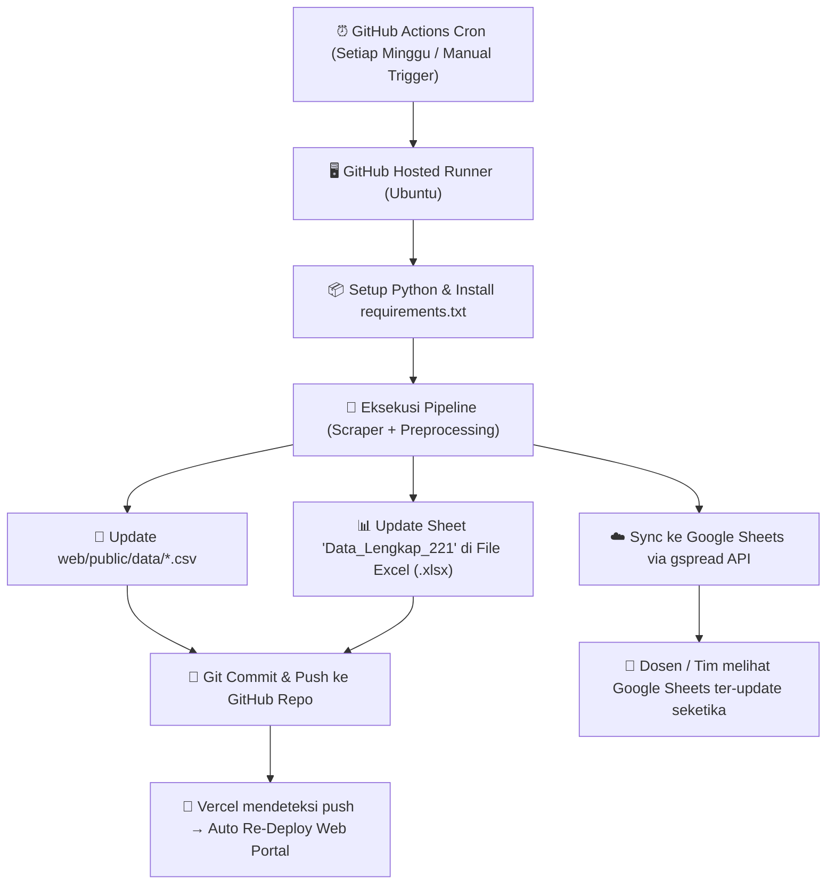

# Rencana Implementasi CI/CD & Otomatisasi Sinkronisasi Data SPK

Dokumen ini memuat panduan arsitektur dan langkah implementasi otomatisasi mingguan (*scheduled pipeline*) untuk proyek **Sistem Pendukung Keputusan (SPK) Rekomendasi Lowongan Part-Time UKRIDA**.

---

## 1. Ringkasan & Tujuan Arsitektur

Otomatisasi ini dirancang agar seluruh siklus data berjalan mandiri tanpa campur tangan manual:
1. **Scraping & Data Preparation:** Skrip Python berjalan otomatis seminggu sekali di cloud (GitHub Actions).
2. **Sinkronisasi Web React:** Memperbarui file CSV di `web/public/data/`, lalu memicu *auto-redeploy* ke Vercel/Netlify.
3. **Sinkronisasi File Excel (.xlsx):** Memperbarui data pada file Excel yang sama persis (tanpa membuat file bertingkat seperti `_v1`, `_v2`, `_v5`) dengan tetap mempertahankan struktur formula dan format sel.
4. **Sinkronisasi Google Sheets:** Memperbarui baris data di Google Sheets secara *live* melalui Google Sheets API agar dosen dan anggota tim dapat langsung memantau data terbaru via link browser.

---

## 2. Diagram Alur Sistem



---

## 3. Tahap Persiapan (Prerequisites)

### 3.1. Google Cloud Service Account (Google Sheets API)
1. Buka [Google Cloud Console](https://console.cloud.google.com/).
2. Buat proyek baru: `spk-parttime-ukrida`.
3. Aktifkan 2 API di menu **APIs & Services > Library**:
   - **Google Sheets API**
   - **Google Drive API**
4. Buat Service Account di **IAM & Admin > Service Accounts**:
   - Beri nama: `spk-sheets-sync`.
   - Buka akun tersebut > tab **Keys** > **Add Key** > **Create new key** > pilih format **JSON**.
   - Simpan file JSON (misal `service_account.json`). Jangan commit file ini ke Git!
5. Salin alamat email Service Account (contoh: `spk-sheets-sync@spk-parttime-ukrida.iam.gserviceaccount.com`).
6. Buka file Google Sheets proyek Anda, klik tombol **Bagikan / Share**, lalu masukkan email Service Account tersebut dengan peran **Editor**.

### 3.2. Konfigurasi GitHub Repository Secrets
Di repositori GitHub Anda, buka menu **Settings** > **Secrets and variables** > **Actions** > klik **New repository secret**:
* `GCP_SA_KEY`: Isi dengan seluruh teks yang ada di dalam file `service_account.json`.
* `SPREADSHEET_ID`: Isi dengan ID Google Sheet Anda (karakter acak panjang di URL browser antara `/d/` dan `/edit`).

---

## 4. Implementasi Skrip Python

### 4.1. Tambahkan Dependensi ke `requirements.txt`
Tambahkan dependensi berikut ke file [requirements.txt](file:///C:/Users/ASUS/Desktop/phase-3/requirements.txt):
```text
openpyxl>=3.1.0
gspread>=6.0.0
google-auth>=2.0.0
```

### 4.2. Skrip Sinkronisasi Excel & Google Sheets (`scripts/sync_data.py`)
Buat skrip helper khusus untuk menangani update ke file Excel lokal dan Google Sheets tanpa merusak formula:

```python
import os
import json
import gspread
import openpyxl
import pandas as pd
from pathlib import Path

# Path konfigurasi
BASE_DIR = Path(__file__).resolve().parent.parent
CSV_CLEAN_PATH = BASE_DIR / "web" / "public" / "data" / "clean_jobs_dataset.csv"
EXCEL_PATH = BASE_DIR / "SPK_SMARTER_PartTime_UKRIDA_Spreadsheet.xlsx"

def sync_to_excel(df: pd.DataFrame):
    """Update baris data di file Excel yang sama tanpa membuat file baru."""
    if not EXCEL_PATH.exists():
        print(f"[WARN] File Excel {EXCEL_PATH} tidak ditemukan. Melewati sync Excel.")
        return

    wb = openpyxl.load_workbook(EXCEL_PATH)
    sheet_name = "Data_Lengkap_221"
    
    if sheet_name in wb.sheetnames:
        ws = wb[sheet_name]
        
        # Kosongkan baris lama mulai dari baris ke-6 (sesuaikan dengan template header Anda)
        for row in ws.iter_rows(min_row=6, max_row=ws.max_row, min_col=1, max_col=df.shape[1]):
            for cell in row:
                cell.value = None
        
        # Tulis data baru
        for r_idx, row_data in enumerate(df.values, start=6):
            for c_idx, val in enumerate(row_data, start=1):
                ws.cell(row=r_idx, column=c_idx, value=val)
                
        wb.save(EXCEL_PATH)
        print(f"[OK] Berhasil memperbarui file Excel: {EXCEL_PATH.name}")
    else:
        print(f"[WARN] Sheet '{sheet_name}' tidak ditemukan di workbook.")

def sync_to_google_sheets(df: pd.DataFrame):
    """Sinkronisasi data langsung ke Google Sheets secara batch (hemat kuota API)."""
    sa_key_str = os.getenv("GCP_SA_KEY")
    spreadsheet_id = os.getenv("SPREADSHEET_ID")
    
    if not sa_key_str or not spreadsheet_id:
        print("[INFO] Variabel GCP_SA_KEY atau SPREADSHEET_ID tidak diset. Melewati sync Google Sheets.")
        return

    try:
        service_account_info = json.loads(sa_key_str)
        gc = gspread.service_account_from_dict(service_account_info)
        sh = gc.open_by_key(spreadsheet_id)
        ws = sh.worksheet("Data_Lengkap_221")
        
        # Format ke bentuk matriks list of lists
        header = df.columns.values.tolist()
        rows = df.fillna("").values.tolist()
        payload = [header] + rows
        
        # Update dalam 1 request HTTP
        ws.update(values=payload, range_name="A5")
        print("[OK] Berhasil sinkronisasi ke Google Sheets!")
    except Exception as e:
        print(f"[ERROR] Gagal sinkronisasi Google Sheets: {e}")

if __name__ == "__main__":
    if CSV_CLEAN_PATH.exists():
        df_jobs = pd.read_csv(CSV_CLEAN_PATH)
        sync_to_excel(df_jobs)
        sync_to_google_sheets(df_jobs)
    else:
        print(f"[ERROR] File CSV {CSV_CLEAN_PATH} belum digenerate.")
```

---

## 5. Konfigurasi CI/CD Workflow (`.github/workflows/weekly_sync.yml`)

Buat file baru di path `.github/workflows/weekly_sync.yml`:

```yaml
name: Weekly Job Scraping, SPK Pipeline & Sync

on:
  schedule:
    # Berjalan otomatis setiap hari Minggu jam 00:00 UTC (07:00 WIB)
    - cron: '0 0 * * 0'
  # Memungkinkan tim menjalankan secara manual melalui tab Actions di GitHub
  workflow_dispatch:

jobs:
  scrape-and-sync:
    runs-on: ubuntu-latest
    permissions:
      contents: write

    steps:
      - name: 1. Checkout Repositori
        uses: actions/checkout@v4

      - name: 2. Setup Lingkungan Python
        uses: actions/setup-python@v5
        with:
          python-version: '3.11'
          cache: 'pip'

      - name: 3. Pasang Dependensi Python
        run: |
          python -m pip install --upgrade pip
          pip install -r requirements.txt

      - name: 4. Jalankan Pipeline Data Preparation
        run: |
          # Jalankan pipeline pembersihan & pembuatan dataset matriks SPK
          python -m src.pipeline

      - name: 5. Sinkronisasi ke Excel & Google Sheets
        env:
          GCP_SA_KEY: ${{ secrets.GCP_SA_KEY }}
          SPREADSHEET_ID: ${{ secrets.SPREADSHEET_ID }}
        run: |
          python scripts/sync_data.py

      - name: 6. Commit & Push Perubahan ke GitHub
        run: |
          git config --global user.name "github-actions[bot]"
          git config --global user.email "github-actions[bot]@users.noreply.github.com"
          
          # Tambahkan hanya file artefak data yang diperbarui
          git add web/public/data/*.csv data/processed/*.csv SPK_SMARTER_PartTime_UKRIDA_Spreadsheet.xlsx
          
          # Periksa apakah ada perubahan nyata sebelum melakukan commit
          if git diff --staged --quiet; then
            echo "Tidak ada perubahan dataset pada eksekusi minggu ini."
          else
            git commit -m "chore(auto-sync): update mingguan dataset lowongan & spreadsheet [skip ci]"
            git push
          fi
```

---

## 6. Alur Pasca-Push (Vercel / Netlify Deployment)

1. **Trigger Otomatis:** Ketika GitHub Actions melakukan `git push` pada langkah ke-6, webhook Vercel/Netlify akan otomatis aktif.
2. **Build Web:** Vercel menjalankan `npm run build` di folder `web`.
3. **Penyajian Data:** File CSV terbaru di `web/public/data/` otomatis ter-bundle ke folder distribusi `dist/`, sehingga seluruh pengunjung web langsung melihat daftar rekomendasi loker terbaru.

---

## 7. Rangkuman Keunggulan Plan Ini

| Kebutuhan | Solusi yang Diterapkan | Status |
|---|---|---|
| **Otomatis Tanpa Server** | Menggunakan GitHub Actions (Gratis 2.000 menit/bulan). |  100% Bebas Biaya |
| **Satu File Excel Tetap** | Diedit via `openpyxl` langsung pada file yang sama; riwayat versi dicatat oleh Git history. |  Tidak ada lagi `_v1`, `_v2` |
| **Kolaborasi Google Sheets** | Di-update batch 1 kali lewat `gspread` menggunakan Google Service Account. |  Aman dari kuota & live |
| **Web Portal Ter-update** | Vercel otomatis re-deploy setiap ada commit data baru dari bot. |  Real-time sync |
