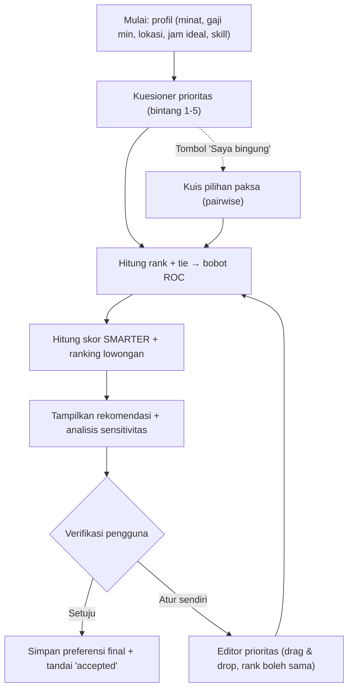

# Plan: Kuesioner Preferensi Prioritas, Rekomendasi SMARTER, dan Verifikasi Pengguna

Status: rencana (belum diimplementasikan)
Konteks: SPK rekomendasi part-time UKRIDA, metode SMARTER + bobot ROC (K = 5 kriteria).

## 1. Latar Belakang & Masalah

- Kuesioner awal tidak memuat pertanyaan prioritas kriteria (gaji, lokasi, dll.).
- Bobot ROC untuk K = 5 selalu tetap (0,4567 / 0,2567 / 0,1567 / 0,0900 / 0,0400). Yang personal adalah **kriteria mana menduduki rank mana**.
- Rank default saat ini (Gaji > Jam > Lokasi > Kategori > Skill) harus disebut **asumsi tim/pakar**, bukan hasil survei.
- Solusi: prioritas dikumpulkan **di web**, bukan lewat kuesioner baru.

## 2. Tujuan

1. Pengguna mengisi preferensi lewat kuesioner di web.
2. Sistem menghitung rank kriteria dari jawaban, lalu bobot ROC.
3. Rank yang sama didukung (kriteria seri berbagi bobot rata-rata).
4. Sistem menampilkan rekomendasi + sensitivitas.
5. Pengguna memverifikasi: **setuju** atau **atur ulang sendiri**.

## 3. Alur Pengguna (User Flow)



## 4. Perhitungan (Spesifikasi)

### 4.1 Dari kuesioner ke skor kepentingan
Metode utama: **skala bintang 1–5 per kriteria** (C1–C5).
- Seri alami terjadi jika bintang sama.
- Pernyataan "ingin jam kerja banyak" → isi `jam_ideal` tinggi (mis. 25–30). Alasan: C4 = `max(0, 1 − |jam − jam_ideal|/20)` mengukur kedekatan, bukan "makin banyak makin baik".

Metode bantuan (tombol "Saya bingung"): **kuis pilihan paksa** 10 pasangan kriteria.
1. Tiap kemenangan = 1 poin untuk kriteria itu.
2. Urutkan poin menurun → rank. Poin sama → seri.

### 4.2 Dari skor ke rank (dengan seri)
Gunakan competition-style ordering: urutkan skor menurun, kelompokkan skor sama menjadi satu grup yang menduduki posisi berurutan.

### 4.3 Bobot ROC dengan seri
Bobot posisi p (K = 5): `ROC(p) = (1/K) · Σ_{k=p..K} 1/k`.
Kriteria yang seri pada posisi p..q mendapat:

```
w = rata-rata( ROC(p), ..., ROC(q) )
```

Contoh: Gaji & Jam bintang 5 (posisi 1–2) → (0,4567 + 0,2567)/2 = **0,3567** masing-masing. Total bobot tetap 1.

### 4.4 Skor & ranking lowongan (tidak berubah dari model sekarang)
- Utilitas: `u = (X − MIN)/(MAX − MIN)` (jika MAX = MIN → 1).
- Skor: `U(Ai) = Σ w_j · u_ij`.
- Ranking: urut menurun.

### 4.5 Analisis sensitivitas
Tujuan: menunjukkan seberapa stabil rekomendasi terhadap perubahan prioritas.

- **Skenario "pemimpin tunggal"**: 5 skenario di mana tiap kriteria sekali menjadi rank 1 (sisanya mengikuti urutan pengguna). Tampilkan juara 1–3 tiap skenario.
- **Stabilitas top-N**: jalankan semua 120 permutasi rank (5!) → hitung persentase tiap lowongan masuk top-3. Tampilkan "Stabil" (≥ 70%), "Sedang", "Sensitif".
- **Pesan ke pengguna**, contoh: "Lowongan B unggul bila Anda mengutamakan lokasi; A unggul bila mengutamakan gaji."

## 5. Verifikasi Pengguna (Fitur Baru)

Setelah hasil muncul, tampilkan panel konfirmasi:

| Tombol | Aksi |
|---|---|
| **Setuju dengan rekomendasi** | Simpan `rank final`, tandai `accepted = true` |
| **Atur kriteria sendiri** | Buka editor prioritas, hitung ulang real-time |
| **Reset ke saran sistem** | Kembalikan rank dari kuesioner |

Data yang disimpan per sesi (anonim, tanpa NIM):
- Profil pengguna, rank awal (dari sistem), rank final.
- Status verifikasi: `accepted_initial` / `edited`.
- Jumlah edit, waktu, top-3 lowongan.
Gunanya: bukti validasi (persentase pengguna yang langsung setuju) untuk laporan.

## 6. Desain UI

1. **Kuesioner prioritas**: 5 kartu kriteria + bintang 1–5, contoh singkat tiap kriteria.
2. **Tombol "Saya bingung"**: modal kuis 10 pasangan.
3. **Panel prioritas**: daftar kriteria yang bisa digeser; kriteria seri ditampilkan dalam satu baris grup dengan badge "Rank sama".
4. **Hasil**: daftar lowongan ter-ranking, skor, kontribusi per kriteria (bar).
5. **Panel sensitivitas**: tabel skenario + badge stabilitas.
6. **Panel verifikasi**: dua tombol utama (Setuju / Atur sendiri).
7. Pratinjau live: mengubah rank langsung memperbarui hasil.

Mitigasi anchoring: label "Rekomendasi awal, silakan sesuaikan"; tampilkan efek perubahan saat edit.

## 7. Rencana Teknis (Frontend `web/`)

Berkas yang ada: `App.tsx`, `components/`, `lib/`, `types/` (struktur detail perlu dicek saat implementasi).

| Modul | Tanggung jawab |
|---|---|
| `lib/roc.ts` | `rocWeights(K)`, `weightsWithTies(ranks)` |
| `lib/priority.ts` | Bintang → rank + grup seri; kuis pairwise → rank |
| `lib/smarter.ts` | Utilitas, skor, ranking |
| `lib/sensitivity.ts` | Skenario pemimpin tunggal, permutasi top-N |
| `components/PriorityQuestionnaire.tsx` | Form bintang |
| `components/PairwiseQuiz.tsx` | Kuis "Saya bingung" |
| `components/PriorityEditor.tsx` | Drag & drop + rank sama |
| `components/SensitivityPanel.tsx` | Tabel sensitivitas |
| `components/VerificationPanel.tsx` | Setuju / Atur sendiri |
| `types/` | Tipe `Priority`, `Weights`, `SessionRecord` |

Penyimpanan sesi: awal cukup `localStorage`; opsional backend / Google Sheets bila ingin agregasi.

## 8. Fase Pengerjaan

1. **Inti perhitungan**: `roc.ts`, `priority.ts`, `smarter.ts` + uji unit (pastikan total bobot = 1, kasus seri, MAX = MIN).
2. **Kuesioner & editor** prioritas dengan dukungan rank sama.
3. **Hasil + sensitivitas.**
4. **Verifikasi** + penyimpanan sesi.
5. **Kuis pairwise** "Saya bingung".
6. **Dokumentasi**: update README & cheatsheet (rank default = asumsi tim; jelaskan ekstensi seri).
7. **Uji pengguna** dengan beberapa mahasiswa, ukur % langsung setuju.

## 9. Pengujian

- Unit: bobot ROC (0,4567…), seri 2-kriteria (0,3567 / 0,3567), seri semua kriteria (0,2 masing-masing), total = 1.
- Cocokkan hasil web dengan spreadsheet `SPK_SMARTER_..._v4.xlsx` (JOB-1174 = 0,8700 untuk MHS-101).
- Skenario sensitivitas: contoh 3 lowongan (A/B/C) → hasil default A > B > C, lokasi-dulu B > C > A.

## 10. Risiko & Catatan

| Risiko | Mitigasi |
|---|---|
| Pengguna menerima saran begitu saja (anchoring) | Preview live, label "sesuaikan", tampilkan sensitivitas |
| Semua kriteria seri | Bobot sama 0,2; tampilkan peringatan "Tidak ada prioritas" |
| README menyebut rank default dari "survei Fase 2" | Ubah jadi "asumsi tim/pakar" |
| SMARTER standar memerlukan rank unik | Dokumentasikan sebagai ekstensi (rata-rata bobot ROC) |
| Tie menyebabkan skor lowongan sama | Sama seperti kasus JOB-1174/JOB-1260; jelaskan perilaku `RANK` |

## 11. Pertanyaan Terbuka

1. Backend untuk menyimpan sesi, atau cukup `localStorage`?
2. Kuis pairwise 10 pertanyaan atau versi singkat 5 pertanyaan?
3. Ambang stabilitas (70% / 40%) disetujui?
4. Apakah hasil verifikasi dipakai sebagai metrik evaluasi di laporan?
